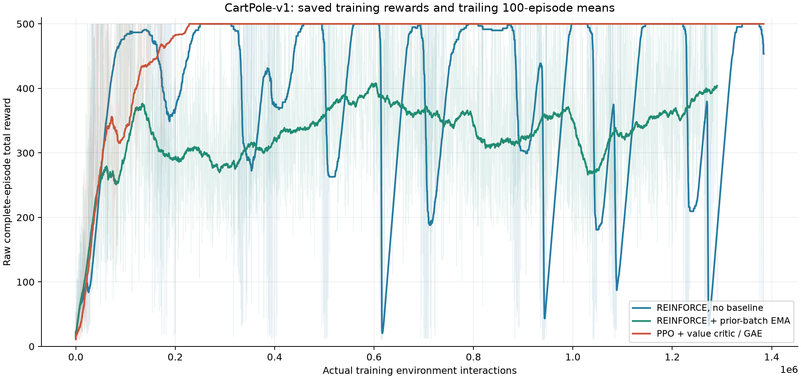
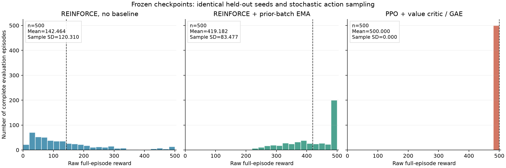
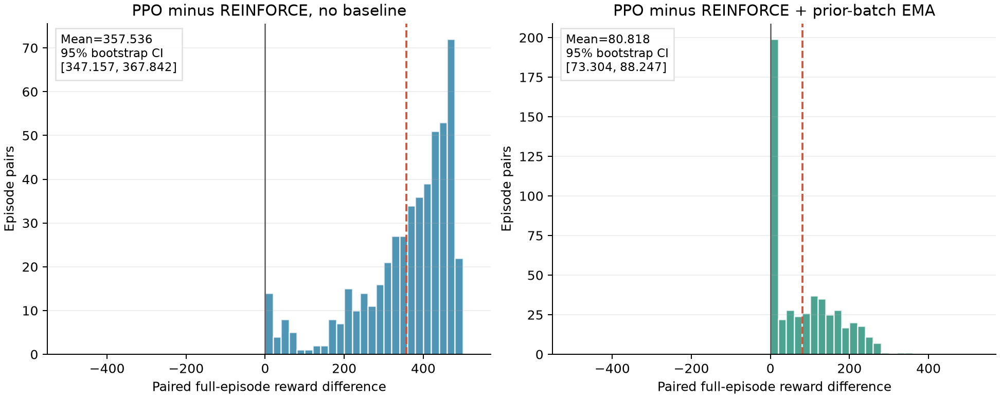

# CartPole: PPO comparison with REINFORCE

We compare PPO-Clip with basic REINFORCE and REINFORCE with a prior-batch EMA baseline on CartPole-v1.

## Design and method

PPO and basic REINFORCE each use 1,384,029 environment interactions. The EMA reference uses 1,290,047; all three methods therefore do not have identical sample budgets. Each method has one training seed, 101. The final update at the fixed budget is frozen before evaluation.
The actor is 4 inputs -> 64 Tanh units -> 2 action logits, initialized with the same PyTorch seed before constructing any critic. PPO adds a separate 4-64-Tanh-1 state-value critic. All methods use the native CPU CartPole-v1 environment, gamma=.95, original rewards and the official 500-step limit. Actions are sampled rather than chosen by argmax.

PPO uses the following estimators and losses. Old values and log probabilities are frozen at rollout collection. At a natural terminal, next-state value is suppressed. At a TimeLimit, the final observation is bootstrapped but GAE carry stops before the reset episode. A rollout slice bootstraps its last next-state value without becoming an episode termination.

```text
delta_t = r_t + gamma * (1-terminated_t) * V_old(s_next) - V_old(s_t)
A_raw_t = delta_t + gamma * lambda * (1-(terminated_t or truncated_t)) * A_raw_(t+1)
value_target_t = detach(A_raw_t + V_old(s_t))
A_t = detach((A_raw_t - rollout_mean(A_raw)) / (rollout_population_SD(A_raw) + 1e-8))
ratio_t = exp(log pi_new(a_t|s_t) - log pi_old(a_t|s_t))
actor_loss = -mean(min(ratio_t*A_t, clip(ratio_t,1-epsilon,1+epsilon)*A_t))
critic_loss = 0.5 * mean((V_new(s_t) - value_target_t)^2)
```

Here lambda=0.95, epsilon=0.2, actor Adam LR=0.0003, and critic Adam LR=0.001. Each 2048-transition rollout across 8 lanes is reused for 10 epochs in minibatches of 256. Actor and critic gradient norms are clipped at 0.5. Entropy coefficient is 0.0; observation and reward normalization are disabled. The actor surrogate uniformly averages transitions and has no absolute episode-start gamma^t factor.

## Primary fresh paired evaluation

Each frozen model runs 500 complete episodes on the same new seeds 84000000 through 84000499. This set is separate from training, tuning and the historical final evaluation. Per-episode action-sampling uniforms follow the same seeded protocol.

| Method | Full train episodes | Actual train steps | Last 100 train mean | Fresh eval mean | Sample SD | Range |
|---|---:|---:|---:|---:|---:|---|
| REINFORCE, no baseline | 4,096 | 1,384,029 | 453.460 | 142.464 | 120.310 | [12, 500] |
| REINFORCE + prior-batch EMA | 4,096 | 1,290,047 | 404.090 | 419.182 | 83.477 | [153, 500] |
| PPO + value critic / GAE | 3,324 | 1,384,029 | 500.000 | 500.000 | 0.000 | [500, 500] |

PPO reaches the 500-step cap in 500/500 fresh episodes: observed mean 500.000 and sample SD 0.000. Basic REINFORCE reaches the cap in 11/500; EMA REINFORCE in 183/500. These bounded observations do not assess survival beyond 500 steps. Standard deviations use ddof=1; termination and truncation can coincide on step 500.



Figure 1. Faint lines preserve full-episode rewards; solid lines show the trailing 100 complete-episode mean, with a growing window before episode 100. The horizontal axis is actual environment interactions. Equal 100-episode windows span different numbers of transitions. PPO training episodes can cross several policy updates, so their scores are not evaluations of one stationary policy.

The PPO curve first attains a full 100-episode mean of 500 at 228,168 interactions. All 2,311 subsequently completed training episodes also score 500. Basic REINFORCE shows repeated high-score windows and collapses; its last-100 training mean 453.460 does not describe its final frozen evaluation mean 142.464. Earlier checkpoints are not substituted.
PPO logs 3,324 completed training episodes and ends with 8 ongoing episodes containing 1,804 transitions. Completed plus ongoing lengths account for every one of the 1,384,029 interactions. Those unfinished transitions contribute bootstrapped GAE updates but are not counted as full episodes.



Figure 2. The panels share axes and bins. All 500 PPO rewards lie at the official cap; the two REINFORCE distributions remain dispersed. Each count is one complete natural-termination or official-TimeLimit episode. The dashed line marks the mean.

## Optimization work and elapsed time

| Method | Rollout/batch updates | Actor optimizer steps | Critic optimizer steps | Recorded training seconds |
|---|---:|---:|---:|---:|
| REINFORCE, no baseline | 512 | 512 | 0 | 10.482 |
| REINFORCE + prior-batch EMA | 512 | 512 | 0 | 10.282 |
| PPO + value critic / GAE | 676 | 54,070 | 54,070 | 48.426 |

PPO uses 676 rollouts, 54,070 actor steps and 54,070 critic steps. Its recorded 48.426 seconds are 4.62 times the basic run and 4.71 times the EMA run. Equal interactions do not imply equal computation. These are single recorded training timings, not a repeated controlled speed benchmark.

## Paired differences between fixed policies

| PPO minus reference | Pairs | Mean reward difference | Difference sample SD | 95% paired-bootstrap interval | Positive / equal / negative |
|---|---:|---:|---:|---|---|
| REINFORCE, no baseline | 500 | 357.536 | 120.310 | [347.157, 367.842] | 489 / 11 / 0 |
| REINFORCE + prior-batch EMA | 500 | 80.818 | 83.477 | [73.304, 88.247] | 317 / 183 / 0 |



Figure 3. PPO has no negative reward difference in these pairs; ties occur when a reference also reaches 500. Percentile intervals resample the 500 reset-seed/action-uniform pairs 2,000 times using recorded fixed bootstrap seeds. They condition on these frozen policies and exclude training-seed uncertainty.

## Historical evaluation: secondary context

The separate historical seed range remains 80000000-80000499. These results are not pooled with the fresh comparison or used for checkpoint selection.

| Method | Historical episodes | Mean reward | Sample SD |
|---|---:|---:|---:|
| REINFORCE, no baseline | 500 | 143.678 | 125.834 |
| REINFORCE + prior-batch EMA | 500 | 423.592 | 83.414 |
| PPO + value critic / GAE | 500 | 500.000 | 0.000 |

## Algorithm validation

Matched actor initialization has maximum parameter error 0.0. All 6 hand-derived GAE boundary cases match with maximum error 0.0, including natural terminals, TimeLimits, rollout ends and reset-carry blocking. Six signed-advantage clipping cases match the expected loss and derivative.
The first production actor update matches an independent unclipped on-policy calculation with parameter error 0.0; advantages and critic targets receive no gradients. Fixed-target critic MSE falls from 3.995310 to 3.979007.
Checkpoint restoration reproduces actual next-rollout tensors, episode records, both Adam states and actor/critic parameters exactly. The boundary test uses rollouts [64, 64, 15] for exactly 143 steps: 92 completed-episode steps plus 51 ongoing steps. These tests validate mechanics, not general performance superiority.

## Fairness and limits

- PPO changes a bundle: state-value critic, GAE, lower actor learning rate, minibatch reuse, centered/scaled advantages, gradient clipping and uniform transition weighting. Original REINFORCE uses episode-start gamma^t weighting, Monte Carlo returns, Adam LR 0.01, one update per eight full episodes, a fixed 100 loss scale and gradient bound 10. This is not a one-component clipping ablation.
- PPO bootstraps TimeLimits from a critic. Episodic REINFORCE ends its observed discounted objective at the official limit. Therefore estimator target definitions also differ.
- There is one matched training seed; the EMA reference has fewer realized interactions. Evaluation reward SD is distinct from policy-gradient covariance. Bootstrap intervals for fixed policies do not give across-training-seed confidence intervals.
- All PPO scores are capped at 500 in both evaluation sets. The observed zero SD does not establish zero uncertainty on unseen initializations or longer horizons. Repeated training seeds and matched component ablations are needed for causal algorithm claims.

## 中文学习解释

新的配对评估使用 84000000 起的 500 个种子，PPO 均分 500.000、样本标准差 0.000，500/500 回合达到官方上限。基础版和 EMA 版的新评估均分分别为 142.464 和 419.182。原先 80000000 起的结果单列，未混合或用于挑选 checkpoint。
PPO 与基础版环境步数相同，但用了 676 次 rollout 更新、actor 和 critic 各 54,070 次优化，记录训练耗时 48.43 秒，约为基础版的 4.62 倍。它同时改变 critic、GAE、学习率、复用、标准化和时间权重，不能把表现差异只归因于 clipping。
第一张图显示 PPO 的训练表现保持在上限，基础版多次高分后崩落；第二张图是相同新种子的完整评估；第三张图给出配对奖励差。训练未完成片段可用于 bootstrap，但不计为完整回合。单个训练 seed 和固定策略的 bootstrap 不能证明所有训练条件下 PPO 都更好。

## Commands and retained evidence

```sh
.venv/bin/python src/ppo.py train --run runs/cartpole_ppo --steps 1384029 --seed 101
.venv/bin/python src/ppo.py evaluate --run runs/cartpole_ppo --episodes 500 --eval-seed-base 80000000
for run_name in cartpole_basic cartpole_baseline cartpole_ppo; do
  .venv/bin/python src/ppo.py evaluate --run "runs/${run_name}" --output "runs/ppo_comparison_eval/${run_name}" --episodes 500 --eval-seed-base 84000000
done
.venv/bin/python -m src.validate_ppo
.venv/bin/python -m src.compare_ppo
```

The train/evaluate commands preserve frozen or already completed runs. The last command rebuilds the figures and this document without training. Full effective configurations, checkpoint hashes, counters, fresh/historical statistics and bootstrap seeds are retained in [comparison metrics](../data/ppo_comparison_summary.json). Raw logs and protocol files remain under the corresponding run folders.
Quantitative validation: [PPO validation](../data/validation/ppo.json). Additional counter, clipping and original-artifact hash checks: [PPO integrity check](../data/ppo_integrity_check.json).
