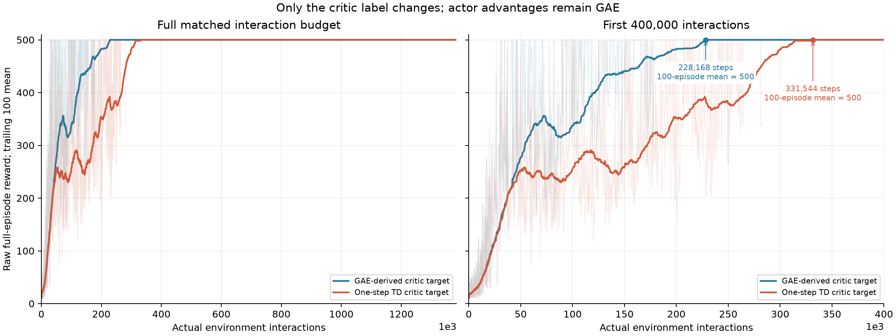
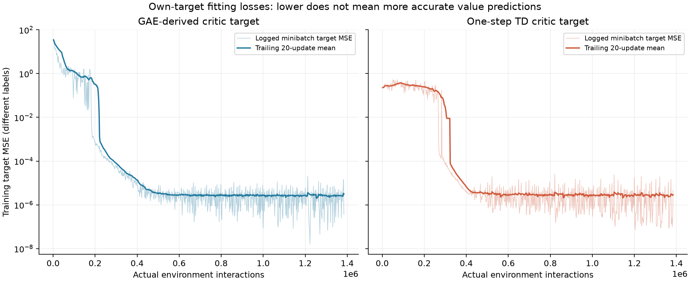
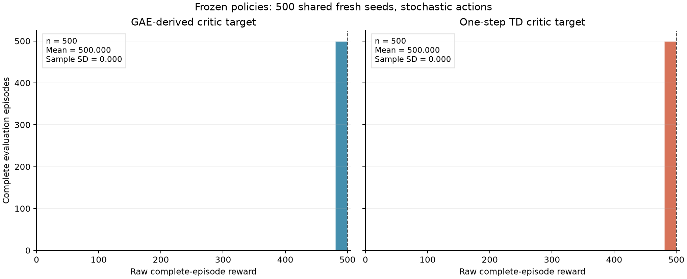
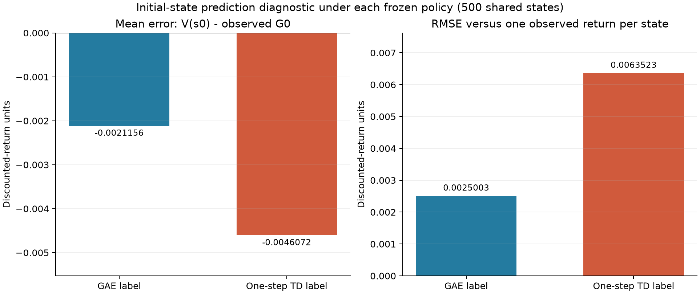

# One-step TD critic target: a PPO ablation

We change only the critic regression label. The actor still uses normalized GAE advantages, gamma=.95 and lambda=.95; the network, initialization, optimizers, data reuse and interaction budget are held fixed.

In this seed, the GAE-derived critic label reaches high training rewards sooner. Both frozen final policies nevertheless reach 500 in all 500 fresh evaluations; the official score cap makes their final observed rewards tie.

## What changes

```text
delta_t = r_t + gamma * (1-terminated_t) * V_old(s_next) - V_old(s_t)
A_GAE_t = delta_t + gamma*lambda*(1-(terminated_t or truncated_t))*A_GAE_(t+1)
GAE critic label:      y_t = V_old(s_t) + A_GAE_t
One-step TD label:     y_t = r_t + gamma*(1-terminated_t)*V_old(s_next)
Both critic losses:    0.5 * mean((V_new(s_t) - detach(y_t))^2)
Both actor advantages: detach(normalize(A_GAE_t))
```

Both labels use the frozen rollout critic throughout all reuse epochs. A TimeLimit bootstraps the final observation; a natural terminal suppresses bootstrap. GAE carry stops at either termination flag. A rollout boundary is not an episode ending. One-step TD here means a one-transition target, not TD(lambda) with lambda=1.

The configuration audit finds only these changed fields: critic_target, value_target. Both arms use seed 101, actor 4-64-Tanh-2, critic 4-64-Tanh-1, actor Adam LR .0003, critic Adam LR .001, clip ratio .2, 2048-transition rollouts over 8 lanes, 10 epochs, minibatches of 256 and gradient bound .5. The critic change can affect later GAE values and sampled policies even though the actor formula is unchanged.

## Training and complete-episode results

| Critic label | Actual train steps | Complete train episodes | Last 100 reward mean | First 100-window >=475 | First 100-window =500 |
|---|---:|---:|---:|---:|---:|
| GAE-derived critic target | 1,384,029 | 3,324 | 500.000 | 191,856 | 228,168 |
| One-step TD critic target | 1,384,029 | 3,554 | 500.000 | 297,448 | 331,544 |



Figure 1. Raw complete-episode rewards are faint; trailing 100-episode means are solid. Before 100 episodes the mean uses all available episodes. Both panels use actual interactions; the right panel zooms to 400,000 and marks each first full 100-episode mean of 500. Crossing a training-window threshold is descriptive and does not evaluate a frozen intermediate policy. PPO episodes can span multiple updates.

After first reaching a full 100-episode mean of 500, the next 2,311 GAE-label episodes and 2,104 one-step-TD-label episodes all score 500: neither arm collapses later in this recorded run. The one-step label reaches that first window 103,376 interactions later. This is a single-seed trajectory comparison, not a population sample-efficiency estimate.

## Critic training losses



Figure 2. Each panel uses twice the logged half-MSE: the unweighted average of pre-update minibatch MSE observations over all reuse epochs. The solid curve averages the most recent 20 updates, with a growing window initially. This is not a final full-rollout MSE after optimization. The labels and their noise/bias differ, so a smaller training loss does not establish more accurate state values. Zero losses, if any, are masked on the logarithmic axis.
First-update own-label MSE is 34.8742 for GAE versus 0.227866 for one-step TD. Last-update values are 3.73188e-07 and 4.67057e-06. The much smaller initial one-step fitting loss does not translate into faster learning or smaller final initial-state prediction discrepancy in this run.

## Fresh frozen-policy evaluation

Both models are frozen before 500 complete stochastic-action episodes on seeds 88000000-88000499. Original rewards and the official 500-step limit are retained. No rollout slice is counted as an episode.

| Critic label | Mean raw reward | Sample SD | Range | At 500-step cap |
|---|---:|---:|---|---:|
| GAE-derived critic target | 500.000 | 0.000 | [500, 500] | 500/500 |
| One-step TD critic target | 500.000 | 0.000 | [500, 500] | 500/500 |



Figure 3. Identical axes and bins show every full-episode reward. SD uses ddof=1. If both methods reach the score cap, this evaluation cannot distinguish their robustness beyond 500 steps; it does not force a winner from training curves.

## A common initial-state prediction diagnostic

| Critic label | States | Mean V(s0) | Mean observed G0 | Bias V-G | RMSE |
|---|---:|---:|---:|---:|---:|
| GAE-derived critic target | 500 | 19.9978844 | 20.0000000 | -0.002115574 | 0.002500285 |
| One-step TD critic target | 500 | 19.9953928 | 20.0000000 | -0.004607223 | 0.006352277 |



Figure 4. Reset states are identical across arms, but each Monte Carlo return follows its own frozen policy and one sampled trajectory. Predictions use no gradients. These are errors relative to observed returns, not known true state values. One sampled return per state can contain Monte Carlo noise; here all observed G0 values are identical because all episodes reach the cap, so observed error variation comes from predictions across states. These are not the training losses in Figure 2. At a 500-step truncation, the maximum omitted continuation contribution at reset is .95^500/(1-.95), below 1e-9.
Both critics slightly underpredict the observed initial-state returns. The GAE-label critic has bias -0.0021156 and RMSE 0.0025003; one-step TD has bias -0.0046072 and RMSE 0.0063523. The latter discrepancy is larger in this held-out set, despite its smaller initial own-label training loss. This does not identify the exact conditional value error or generalize across training seeds.

## Mechanism validation

Independent hand targets match one-step TD with maximum error 0.0. On the matched first batch, actor parameters remain identical (error 0.0), while critic parameters differ by 0.00037194; targets remain frozen throughout reuse. A separate 143-step interruption/resume check reproduces all numerical state exactly. These tests support the intended label-only intervention.

## Scope and interpretation

Both arms use 1,384,029 actual interactions and 676 rollout updates. The baseline uses 54,070 actor and 54,070 critic steps; one-step TD uses 54,070 and 54,070. Recorded training times are 48.426 and 47.600 seconds, not repeated controlled timing estimates. Each arm accounts separately for ongoing episodes at the budget.
This is a one-training-seed ablation. Matching architecture, seed and hyperparameters isolates the implemented label change for this run, but does not establish superiority across training seeds. Final reward SD, critic own-target fitting loss and initial-state Monte Carlo prediction RMSE are three different statistics. Final evaluation does not select checkpoints.

## 中文直观解释

Actor 的优势估计仍是 GAE；只把 Critic 的“参考答案”从 GAE 推导的多步标签换成一步 TD：先看当前奖励，再加旧 Critic 对下一状态的折扣估计。训练图展示分数如何随真实交互步数变化，前 40 万步放大图标出两种方法首次完整 100 回合窗口均分达到 500 的位置。
这个 seed 下，GAE 标签首次最近 100 回合平均达到 475/500 分分别在 191,856/228,168 步，一步 TD 是 297,448/331,544 步，前者学得更早。达到 500 窗口后两者都没有再出现低于 500 的完整训练回合。最后各自 500 个新种子评估均为 500 分、样本 SD 为 0，最终观测成绩相同。
两种参考答案不同，不能因为第二张图的训练 MSE 更低就说 Critic 更准。第四张图改用相同初始状态的实际折扣回报作为共同诊断，但每个状态仍只有各自策略的一条随机轨迹，并非已知真值。最终直方图要单独看；若都达到 500 分，只能说这批完整评估都碰到了上限。

## Reproduction and evidence

```sh
.venv/bin/python -m src.compare_td1_critic
```

The command only reads frozen checkpoints, configurations, complete training/evaluation CSVs and initial-value diagnostics, then rebuilds four figures and this document. It does not train or modify the original report. Raw source paths and all counters are retained in [comparison metrics](../data/td1_critic_comparison.json). Validation evidence: [one-step TD critic validation](../data/validation/td1_critic.json).
