# Reinforcement Learning Assignment 1

Yujun Sun | October 2026

This report studies shuttle dispatching using finite-horizon enumeration, value iteration, and policy iteration. It also compares Monte Carlo REINFORCE with and without a scalar baseline on CartPole-v1 and Pong-v5, examining learning performance, gradient variance, and algorithm correctness.

### Code and data

GitHub username: SAMSUNYUJUN. Repository: mlds-rl-assignment1.

[GitHub repository: https://github.com/SAMSUNYUJUN/mlds-rl-assignment1](https://github.com/SAMSUNYUJUN/mlds-rl-assignment1)

### Evaluation summary

| Model | Train episodes | Eval episodes | Mean reward | Sample SD |
| --- | --- | --- | --- | --- |
| CartPole basic | 4096 | 500 | 143.678 | 125.834 |
| Pong basic | 4096 | 500 | -20.534 | 0.706 |
| CartPole baseline | 4096 | 500 | 423.592 | 83.414 |
| Pong baseline | 4096 | 500 | -19.806 | 1.046 |

The experiments comprise 10,689,593 training steps and 2,000 held-out evaluation episodes totaling 1,290,169 steps. Evaluation samples actions from each fixed final policy. Checkpoints are selected at the predetermined training endpoint, independently of evaluation rewards.

Reward means and sample standard deviations describe raw undiscounted complete-episode totals. They are distinct from the discounted optimization objective and from the variance of a gradient estimator. All four models are single-training-seed experiments; comparisons describe these runs rather than population-level causal effects.

<!-- page break -->

## 1. Shuttle model and finite enumeration

State s is the observed queue size in {0,...,200} at a decision epoch. Action a in {0,1} means wait or dispatch one shuttle. Define q(s,a)=max(s-15a,0). The timing is: observe s, choose a, serve up to 15 passengers, charge dispatch plus holding for passengers still waiting, then add an independent uniform arrival A in {1,...,5}. New arrivals are first eligible for service at the next epoch.

```text
c(s,a) = 100 a + 2 max(s - 15 a, 0)
s_next = min(200, max(s - 15 a, 0) + A)
P(s_next=j | s,a) = (1/5) sum_{A=1}^5 1[j=s_next(s,a,A)]
V_pi(s) = E_pi[sum_{t=0}^infinity 0.95^t c(s_t,a_t) | s_0=s]
```

Value functions represent expected discounted costs, which are minimized. Empty or underfilled dispatch is allowed, costs 100, and serves min(s,15) passengers. At most one shuttle leaves per epoch. Arrivals above the queue cap of 200 are discarded without an overflow penalty; equal clipped successor states accumulate probability. Underfilled service and overflow handling are modeling assumptions.

Finite-horizon enumeration considers both actions and all five arrival outcomes through backward recursion, with T=500 and terminal value V_T(s)=0. Reusing state values at each time step avoids exponential enumeration of complete trajectories.

```text
V_t(s) = min_a { c(s,a) + 0.95 sum_j P(j|s,a) V_{t+1}(j) }
V_500(s)=0; t=499,...,0
```

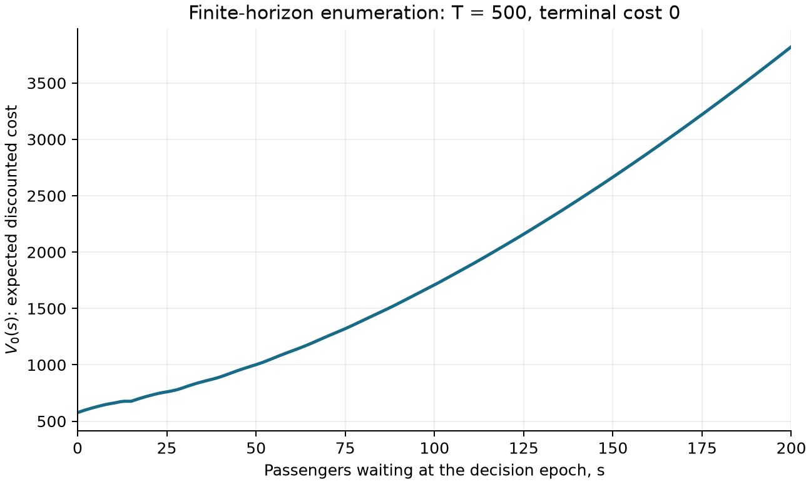

At s=0 the computed cost is 576.670168; at s=200 it is 3,821.586477. More initial waiting increases cost through holding and the number of successive dispatches required.

<!-- page break -->

## 2. Infinite-horizon shuttle solutions

Value iteration starts at V=0 and repeatedly applies the minimum-cost Bellman operator until the maximum successive change is at most 1e-10. The contraction factor is 0.95. Policy iteration starts with never dispatching, solves (I-gamma P_pi)V=c_pi in float64, and improves all actions until the policy stops changing. Ties are resolved toward wait.

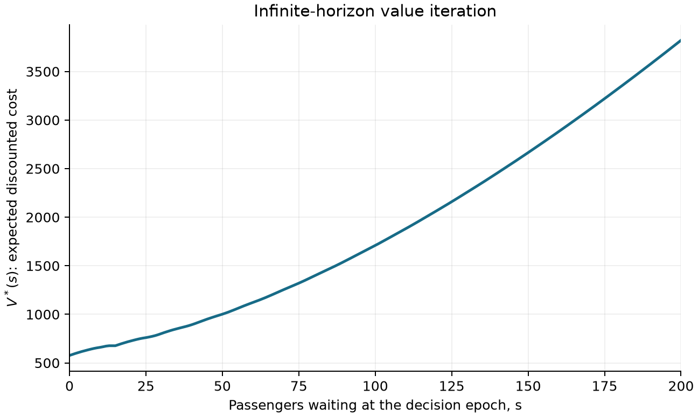

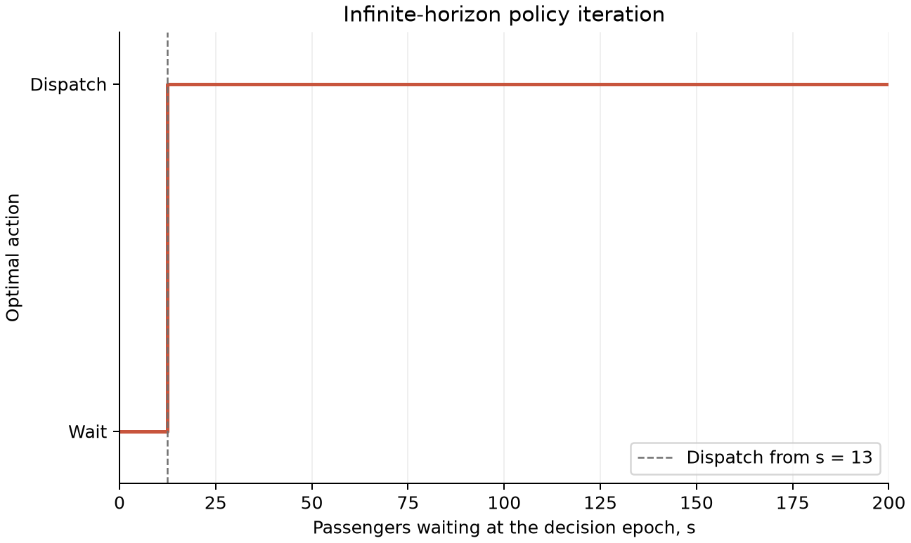

The resulting threshold 13 is below capacity 15. Waiting for a full shuttle is not generally optimal because accumulated holding cost can outweigh unused capacity. The numerical minimum action-value gap is 3.778004, attained at state 12; the selected policy is not a near-tie artifact.

<!-- page break -->

## 3. Shuttle validation and edge cases

```sh
.venv/bin/python src/shuttle.py all
.venv/bin/python src/shuttle.py validate
```

| Test purpose | Theory and running method | Observed result |
| --- | --- | --- |
| Independent small decision tree | A separate recursive exhaustive tree must match the matrix recurrence for all states and horizons. | 40 comparisons; max error 0.000. |
| Hand-derived timing and boundaries | Empty/underfilled service, K, K+1, and cap aggregation must match manual successors/costs. | Max error 0.000 in 8 cases. |
| Deterministic no-arrival control | With A=0, enumerate the number of immediate dispatches followed by waiting forever. | Max value error 1.80e-09. |
| Optimality certificate and solver agreement | Small Bellman residual implies small fixed-point error; VI and PI must agree. | VI residual 9.41e-11; PI 9.09e-13. |
| Finite/infinite horizon tail | Nonnegative omitted tail bounds V_infinity - V_0 at T=500. | Max difference 4.94e-09. |
| Nonoptimal policy reference | Optimal costs cannot exceed a fixed never-dispatch policy. | At s=200 cost improves by 4,178.414. |

The small-tree oracle uses eight states and horizons 0 through 4, recursively visiting every action/outcome subtree without transition tensors or memoization. It therefore tests the expectation/minimization independently of the main solver. The no-arrival test changes the original arrival law only for validation and compares against an analytic discounted dispatch/wait cost.

The maximum VI/PI value difference is 1.86e-09 with 0 policy disagreements. The VI residual gives a sup-norm value-error bound residual/(1-gamma)=1.88e-09. The finite/infinite difference is below the independent geometric tail bound 6.84e-08.

| State/action | Charged cost | Successors or cap probability |
| --- | --- | --- |
| 0 / wait | 0 | 1,2,3,4,5; each 0.2 |
| 0 / dispatch | 100 | same successors as waiting; strictly dominated |
| 14 or 15 / dispatch | 100 | 1,2,3,4,5; each 0.2 |
| 16 / dispatch | 102 | 2,3,4,5,6; each 0.2 |
| 198 / wait | 396 | P(199)=0.2; P(200)=0.8 |
| 200 / dispatch | 470 | 186,187,188,189,190; each 0.2 |

These checks support the stated capped-queue MDP. They do not validate the realism of dropping overflow passengers. A different overflow rule or additional dispatch constraints defines a different decision problem.

<!-- page break -->

## 4. REINFORCE objective and implementation

For an episode of length L, the training objective discounts rewards from the episode start. G_t is return-to-go with time measured relative to t. Evaluation instead uses R=sum_t r_t without discount. CartPole gamma=0.95; Pong gamma=0.99.

```text
J(theta) = E_pi[sum_{t=0}^{L-1} gamma^t r_t]
G_t = sum_{u=t}^{L-1} gamma^(u-t) r_u
loss = -(1/(100 B)) sum_{episode i=1}^B sum_{t=0}^{L_i-1}
       gamma^t log pi_theta(a_it | x_it) detach(G_it - b)
```

The absolute-time gamma^t factor corresponds to the episode-start objective and is separate from the discount inside G_t. Time steps are summed and complete episodes are averaged, with the same fixed scale 100 in every model. The basic estimator uses b=0 and uncentered returns. Adam minimizes the loss, with an aggregate gradient-norm limit of 10.

| Environment | Policy input and network | Episode completion |
| --- | --- | --- |
| CartPole-v1 | Raw 4-vector -> Linear(4,64) -> Tanh -> Linear(64,2); sampled left/right. | Natural failure or official 500-step TimeLimit. |
| ALE/Pong-v5 | RGB image -> crop/downsample/background mask -> 80x80 frame difference -> Linear(6400,64) -> ReLU -> Linear(64,2). Outputs map to environment actions [2,3]. | Natural game end or official ALE 108,000-frame cap; no point/rally boundaries. |

Networks use PyTorch default nn.Linear random initialization, with matched seeds 101 for CartPole and 202 for Pong. Adam uses betas=(0.9,0.999), eps=1e-8 and weight_decay=0.

The Pong environment is ALE/Pong-v5 in Gymnasium 1.4.0 with ale-py 0.12.1. Its six action meanings are NOOP, FIRE, RIGHT, LEFT, RIGHTFIRE, LEFTFIRE. The policy selects RIGHT or LEFT, mapped to indices 2 and 3, using RGB game observations.

Pong uses frameskip=4, sticky action probability=0.25, mode=0, difficulty=0, and the minimal six-action space. Crop rows 35:195, downsample both dimensions by 2, use the red channel, erase colors 144/109 and map other nonzero pixels to 1. Input is current minus previous binary frame, with a zero difference at reset. No frame stack, FIRE/NOOP wrapper, point-based termination, reward clipping, or custom episode shortening is used.

Rollouts run without autograd; the policy parameters remain fixed for the entire update batch. Observations/actions are stored on CPU (Pong observations as int8), then log probabilities are recomputed in bounded chunks of 512. Gradients accumulate over all chunks; exactly one optimizer step occurs after the entire batch. Thus recomputation uses the sampling policy and does not retain long episode graphs. Evaluation uses inference mode with no gradient recording.

<!-- page break -->

## 5. Experimental setup and training budgets

Experiments ran on an Apple M4 Pro MacBook Pro with 24 GB unified memory, macOS 15.6.1, native arm64 Python 3.12.14, and PyTorch 2.14.1. Shuttle dispatching and CartPole use the CPU. Pong device selection compares CPU and MPS performance.

Pong CPU/MPS timing uses the same 64-unit policy, image preprocessing, complete-episode environment configuration, seed sequence, batch size, loss, and Adam update. Throughput includes rollout, Python environment stepping, preprocessing, inference, return calculation, and updates. Device selection uses measured end-to-end environment steps per second rather than matrix throughput alone.

| Device | Duration | Env steps | Steps/s | Mean update | Peak RSS |
| --- | --- | --- | --- | --- | --- |
| cpu | 5.0 min | 1,264,795 | 4,203.1 | 0.04 s | 581.2 MiB |
| mps | 5.0 min | 969,323 | 3,217.4 | 0.09 s | 902.3 MiB |

Pong uses CPU, which achieved the higher end-to-end throughput. Each device was measured in a separate process; peak memory is the process RSS high-water mark.

| Run | Seed | Episodes | Batch | Adam LR | Device | Train time |
| --- | --- | --- | --- | --- | --- | --- |
| CartPole basic | 101 | 4096 | 8 | 0.01 | cpu | 10.48 s |
| Pong basic | 202 | 4096 | 8 | 0.001 | cpu | 16.1 min |
| CartPole baseline | 101 | 4096 | 8 | 0.01 | cpu | 10.28 s |
| Pong baseline | 202 | 4096 | 8 | 0.001 | cpu | 15.8 min |

### Learning-rate pilots

| Pilot | Episodes | Adam LR | Last up-to-100 mean | Time |
| --- | --- | --- | --- | --- |
| pilot_cartpole | 80 | 0.01 | 34.025 | 0.10 s |
| pilot_pong_lr0p001 | 128 | 0.001 | -20.410 | 31.77 s |
| pilot_pong_lr0p01 | 128 | 0.01 | -20.860 | 28.52 s |

Pong uses Adam 0.001 after 128-episode matched tuning pilots: mean diagnostic action entropy was 0.5403 nats at 0.01 and 0.6879 at 0.001. Both lost; neither saturated above probability .999. The lower rate conservatively preserves exploration. Eight diagnostic games per rate are weak single-seed evidence, not proof of final superiority. CartPole retains the default 0.01.

Gradient clipping bound 10 was monitored: clipped updates / all updates = CartPole basic 0/512; Pong basic 0/512; CartPole baseline 0/512; Pong baseline 0/512. A zero count means clipping did not alter the updates in that run.

Each model trains for 4,096 complete episodes, comprising 512 updates of eight episodes. Pilot and benchmark episodes are excluded from this budget. The policy after the final update is evaluated on 500 complete episodes using seeds independent of training and tuning. This fixed stopping rule does not use evaluation rewards for checkpoint selection.

Batch-boundary checkpoints store the policy, Adam state, baseline, episode and step counts, and seed mappings for reproducible resumption.

<!-- page break -->

## 6. CartPole basic: results

4,096 train episodes; 1,384,029 steps; seed 101; Adam 0.01; cpu. First to last 100 means: raw R 36.580 to 453.460; discounted J 15.3171 to 19.8185. The moving window grows from 1 to 100, then stays 100.

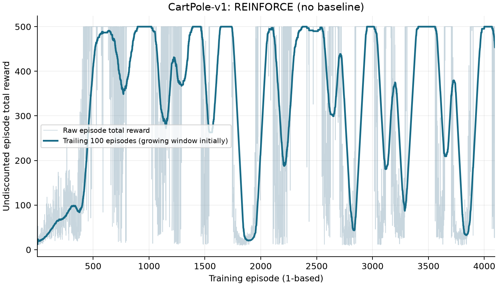

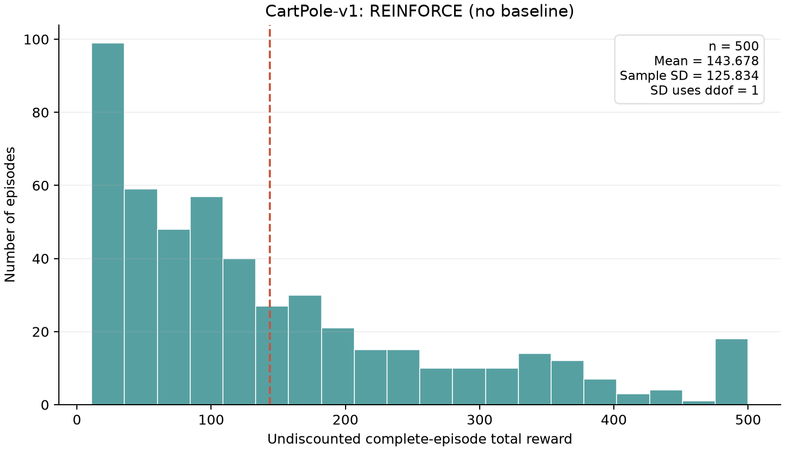

Final mean=143.678; sample SD=125.834 (ddof=1); range [11, 500]; mean length=143.7 steps. Exclusive end cases: natural only 485, time-limit only 15, both flags 0; total 500. Flags may coincide on CartPole step 500.

<!-- page break -->

## 7. Pong basic: results

4,096 train episodes; 4,016,974 steps; seed 202; Adam 0.001; cpu. First to last 100 means: raw R -20.500 to -20.510; discounted J -1.4373 to -1.1791. The moving window grows from 1 to 100, then stays 100.

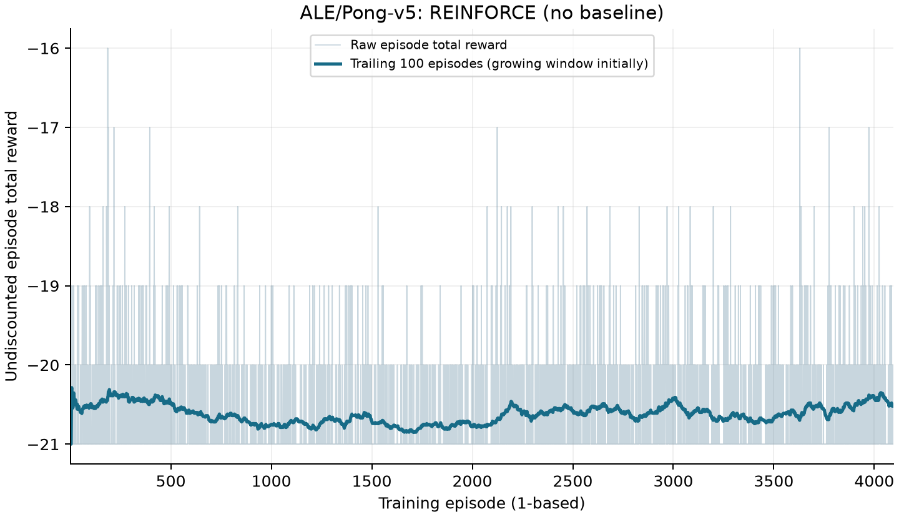

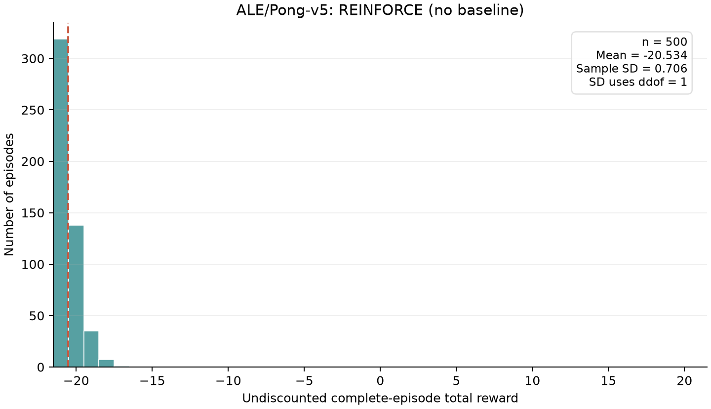

Final mean=-20.534; sample SD=0.706 (ddof=1); range [-21, -17]; mean length=1,019.4 steps. Exclusive end cases: natural only 500, time-limit only 0, both flags 0; total 500.

<!-- page break -->

## 8. CartPole baseline: results

4,096 train episodes; 1,290,047 steps; seed 101; Adam 0.01; cpu. First to last 100 means: raw R 39.490 to 404.090; discounted J 15.7873 to 20.0000. The moving window grows from 1 to 100, then stays 100.

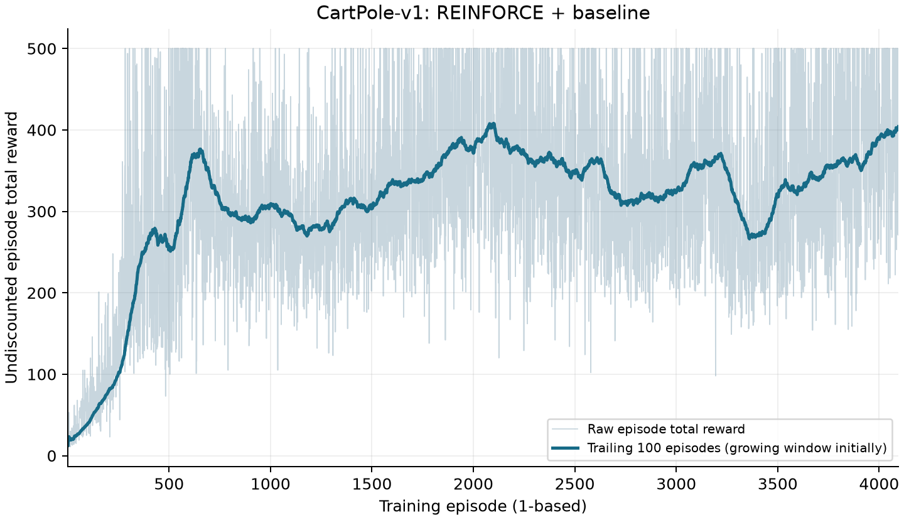

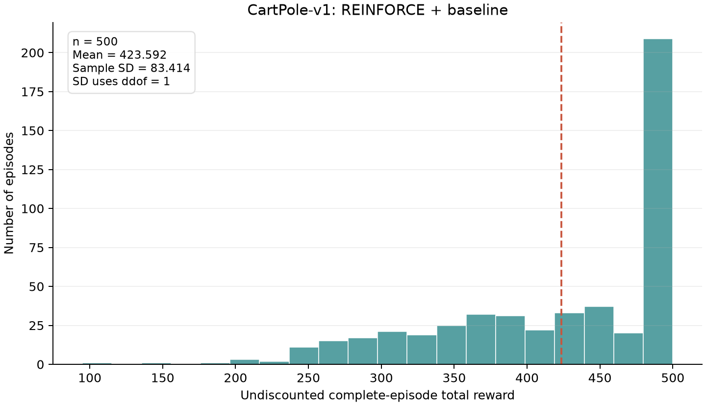

Final mean=423.592; sample SD=83.414 (ddof=1); range [95, 500]; mean length=423.6 steps. Exclusive end cases: natural only 311, time-limit only 187, both flags 2; total 500. Flags may coincide on CartPole step 500.

<!-- page break -->

## 9. Pong baseline: results

4,096 train episodes; 3,998,543 steps; seed 202; Adam 0.001; cpu. First to last 100 means: raw R -20.530 to -19.980; discounted J -1.4323 to -0.2470. The moving window grows from 1 to 100, then stays 100.

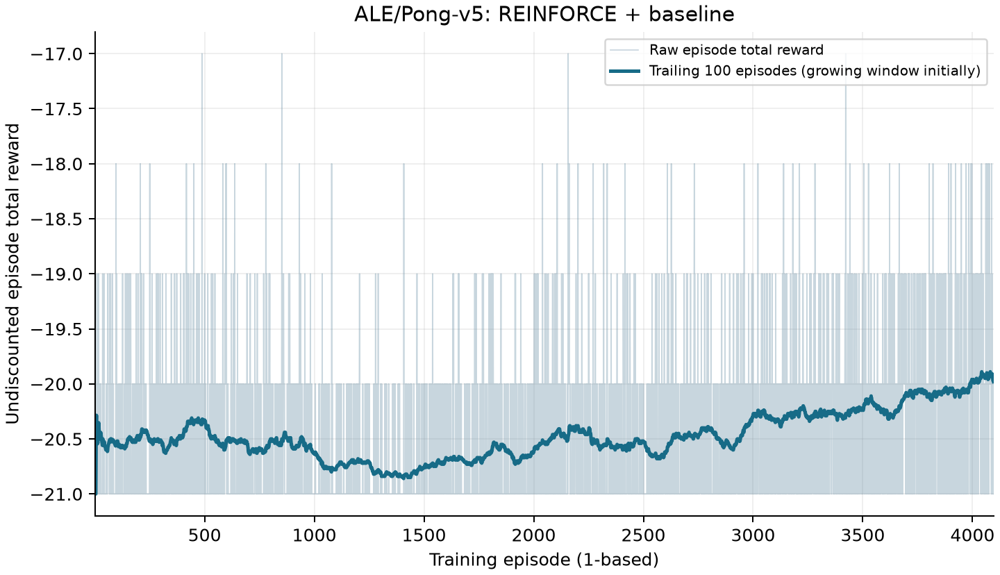

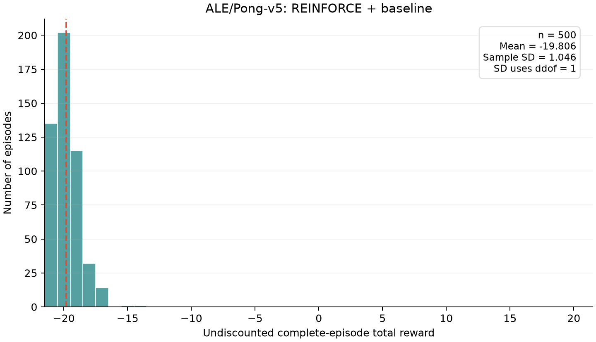

Final mean=-19.806; sample SD=1.046 (ddof=1); range [-21, -14]; mean length=993.6 steps. Exclusive end cases: natural only 500, time-limit only 0, both flags 0; total 500.

<!-- page break -->

## 10. Policy-gradient validation

```sh
.venv/bin/python -m src.validate_rl --output data/validation/rl.json
```

### Hand trajectory and objective weighting

Purpose: detect return indexing, terminal errors and objective mismatch. Theory: rewards [1,2,3], gamma=.95 yield G=[5.6075,4.85,3], with objective weights [1,.95,.9025]. Method: compare the trainer recurrence against direct sums and hand values, including gamma=0/1, empty and one-step cases. Actual maximum error is 8.88e-16. Interpretation: terminal continuation is zero and the final reward is included once.

### Exact trajectory enumeration and update direction

Purpose: validate the stochastic estimator without Monte Carlo error. Theory: three independent Bernoulli actions with p=.35 and rewards [1+2a0,-.5+3a1,2-a2] have dJ/dtheta=p(1-p)(2+3 gamma-gamma^2)=0.89805625. Method: enumerate all eight trajectories and exact probabilities. Actual mean estimator is 0.89805625. Omitting gamma^t instead gives 0.91000000, a bias of 0.01194375.

The float64 PyTorch policy-loss derivative is -0.89805625; the central finite-difference objective derivative is 0.89805625. One small SGD step raises J from 3.711625 to 3.719701. This verifies the loss sign, not Adam convergence in Pong.

### CartPole first-ten-step trace

Purpose: connect the return equations to real state/action/reward transitions. A separate uniform policy uses CartPole reset seed 74219 and Python action seed 74220. It runs the entire episode before returns are calculated; displaying ten rows does not truncate training or evaluation.

| t | Observation (x, xdot, angle, angledot) | a | r | Return-to-go |
| --- | --- | --- | --- | --- |
| 0 | -0.0352, -0.0335, 0.0192, -0.0136 | 1 | 1.0 | 18.011195 |
| 1 | -0.0359, 0.1613, 0.0189, -0.3001 | 1 | 1.0 | 17.906521 |
| 2 | -0.0327, 0.3562, 0.0129, -0.5868 | 0 | 1.0 | 17.796338 |
| 3 | -0.0255, 0.1609, 0.0012, -0.2900 | 0 | 1.0 | 17.680356 |
| 4 | -0.0223, -0.0343, -0.0046, 0.0030 | 1 | 1.0 | 17.558269 |
| 5 | -0.0230, 0.1609, -0.0045, -0.2911 | 1 | 1.0 | 17.429757 |
| 6 | -0.0198, 0.3561, -0.0104, -0.5852 | 1 | 1.0 | 17.294481 |
| 7 | -0.0127, 0.5514, -0.0221, -0.8812 | 0 | 1.0 | 17.152085 |
| 8 | -0.0016, 0.3565, -0.0397, -0.5955 | 0 | 1.0 | 17.002195 |
| 9 | 0.0055, 0.1620, -0.0516, -0.3156 | 0 | 1.0 | 16.844416 |

The complete diagnostic episode length is 45; total reward is 45.0. Its full states, actions, rewards, termination flags, discounted weights and returns are saved in data/validation/rl.json. For +1 CartPole rewards, the geometric return formula independently checks the recurrence. This diagnostic is excluded from the formal evaluation.

<!-- page break -->

## 11. Implementation validation

The implementation tests exercise the policy-gradient estimator, chunked updates, baseline timing, preprocessing, and checkpoint recovery through the training function src.rl.update.

Exact complete trajectory enumeration at p=.5 gives dJ/dtheta=.986875; /100 loss and SGD .01 gives theta=.0000986875 for b=0 and b=2. Chunking and serialization must preserve the update.

Method: Import src.rl; run real update() on all eight trajectories; independently calculate a single-graph Adam update; verify synthetic image pixels; save/load model+Adam+EMA between actual CartPole batches with deterministic episode seeds.

| Validation check | Quantitative result | Interpretation |
| --- | --- | --- |
| Return recurrence | 8.88e-16 max absolute error | The production function agrees with direct hand sums. |
| Exact expected update, b=0 | 9.87e-05 vs 9.87e-05 | Loss sign, gamma weights, fixed scale and batch average agree. |
| Exact expected update, b=2 | 9.87e-05 vs 9.87e-05 | A fixed baseline preserves the expected update. |
| EMA next batch | 2.0790972831 vs theory 2.0790972831 | The update uses b=2, then assigns the completed-batch target to the next batch. |
| Chunked vs independent graph | 2.98e-08 parameter max error; 2.87e-09 loss error | Even chunk size 1 reproduces the independent full graph within float32 precision. |
| Checkpoint roundtrip | Next rollouts identical=True; parameter max error=0.000 | Saved model, Adam and baseline reproduce an actual next CPU update. |
| Image semantics | Test mask pixels=[0, 0, 1, 1]; signed difference range=[-1, 0] | Background removal and negative motion pixels survive preprocessing without mutating the raw image. |

CartPole rollout lengths in the checkpoint experiment were 17, 16, 16, 45, 20, 26, 21, 14. Resumed and uninterrupted runs produced identical trajectories, parameter updates, and baseline values. The comparison covers CPU execution at complete update boundaries.

<!-- page break -->

## 12. Fixed-policy gradient variance

Purpose: measure the implemented saved scalar baseline on actual learned-policy trajectories, and compare task behavior with an uninformed policy. Theory: a scalar fixed before actions preserves the expected gradient but can increase or reduce estimator variance. No optimizer or parameter update occurs; these diagnostics are collected after checkpoints are frozen.

```sh
.venv/bin/python -m src.gradient_diagnostic --run runs/cartpole_baseline --run runs/pong_baseline --episodes 32 --device cpu
```

```text
g_i(b) = sum_t gamma^t grad log pi(a_it | x_it) (G_it-b)/100
trace(sample Cov) = sum_i ||g_i - mean(g)||^2 / (n-1)
```

Method: use the same complete trajectories for b=0 and the saved EMA, with diagnostic seed base 92000000. Recompute float32 production-policy log probabilities in bounded chunks, before clipping and Adam. Float64 online vector moments avoid storing an episode-by-parameter matrix. Raw paired norms, projections and episode records are retained.

| Game | n | Saved b | Trace Cov b=0 | Trace Cov EMA | Ratio EMA/0 |
| --- | --- | --- | --- | --- | --- |
| cartpole | 32 | 19.999752 | 1.598726 | 2.45e-10 | 1.53e-10 |
| pong | 32 | -0.900326 | 0.047282 | 0.025458 | 0.5384 |

Cartpole: the saved baseline gives lower sampled gradient variance in these 32 episodes. Diagnostic mean raw reward is 424.812 and mean length 424.8. Parameters unchanged=True; natural terminations=23; official truncations=9. A finite-sample difference between mean gradients does not establish bias because empirical baseline scores need not average to zero.

Pong: the saved baseline gives lower sampled gradient variance in these 32 episodes. Diagnostic mean raw reward is -20.188 and mean length 935.2. Parameters unchanged=True; natural terminations=32; official truncations=0. A finite-sample difference between mean gradients does not establish bias because empirical baseline scores need not average to zero.

### Separate uniform random-policy reference

| Game | n | Mean raw reward | Sample SD | Mean length |
| --- | --- | --- | --- | --- |
| cartpole | 32 | 20.344 | 8.295 | 20.3 |
| pong | 32 | -20.594 | 0.712 | 1,041.8 |

The reference uses zero logits, the same environment/action set and full termination, graph-free collection, and distinct seed base 93000000. Its raw rewards are excluded from all four final evaluation histograms. These small controls support descriptive interpretation; they are not a statistical test of superiority over independent training runs.

CartPole explanation: many long-survival trajectories have early return-to-go almost equal to 1/(1-.95)=20, close to the saved b=19.9997517. Subtraction removes a nearly constant score-function nuisance. The true episode-start discounted survival gradient can itself be very small because late rewards receive .95^t weight. This explains a very large measured variance reduction without proving a universal baseline advantage. Exact toy identities support unbiasedness; 32 sampled means alone cannot establish or refute it.

These diagnostics do not use the final held-out 500-episode samples to select a checkpoint. Small diagnostic sample counts support mechanism checks, not definitive ranking of the four trained policies.

<!-- page break -->

## 13. Baseline mechanism and variance

The baseline is a scalar EMA carried from earlier complete batches. It is initialized at zero, frozen throughout rollout and the corresponding policy update, and changes only after that update. Its target is the gamma^t-weighted mean return-to-go in the completed batch. It is constant across current states/actions; no value network or critic loss is used.

```text
target_k = [sum_{i,t} gamma^t G_it] / [sum_{i,t} gamma^t]
b_(k+1) = 0.9 b_k + 0.1 target_k
advantage_it = detach(G_it - b_k)
```

Because b_k is fixed before any current-batch actions are sampled, its score-function contribution has expectation zero conditional on earlier training history. A simple return-mean target is not the exact variance-minimizing baseline, which would additionally depend on score magnitudes. Thus it can reduce or increase variance, and cannot guarantee a better final score.

### Exact mechanism checks

| Fixed b | Expected gradient | Gradient-estimator variance |
| --- | --- | --- |
| 0.0 | 0.89805625 | 6.94115144 |
| 2.0 | 0.89805625 | 2.01123013 |
| 8.0 | 0.89805625 | 16.89117447 |

Purpose: check action independence and gradient-estimator variance. Theory: fixed b leaves the expected gradient unchanged. Method: exact eight-trajectory enumeration. A baseline b=2 reduces variance by 71.02%; b=8 increases it. An action-dependent baseline instead has expected gradient 2.30e-17, revealing its bias. The detached baseline receives no gradient in automatic differentiation.

A separate exact enumeration tests why the current batch is not used for its own mean-centering. With N=4 one-step samples, theory predicts factor 1-1/N=.75. Actual expectation changes from 0.45500 to 0.34125, measured ratio 0.75000. This isolates finite-batch self-dependence; the implemented prior-batch EMA avoids it.

<!-- page break -->

## 14. Performance comparison and limitations

CartPole: baseline minus basic final mean reward = 279.914; sample reward-SD change = -42.420. Architecture, environment, training budget, optimizer settings, final evaluation seeds and sampling are matched. These frozen-policy differences do not establish a general baseline benefit.

Pong: baseline minus basic final mean reward = 0.728; sample reward-SD change = 0.341. Architecture, environment, training budget, optimizer settings, final evaluation seeds and sampling are matched. The separate paired gradient diagnostic measures 46.16% lower covariance trace, while raw reward SD is higher. Gradient variance and episode-score variability are different quantities. These frozen-policy differences do not establish a general baseline benefit.

The basic CartPole curve repeatedly reaches the 500-step cap and collapses again. Its last-100 training mean is 453.460, while the final policy evaluates at 143.678. A rolling training window combines trajectories from earlier sampling policies; the final Adam update follows the last logged trajectories and may alter behavior sharply. The baseline final mean 423.592 is higher for this matched seed, although neither model achieves consistently maximal episode returns.

The strict CartPole discounted objective saturates at 20: a 100-step trajectory has J=19.8816, while 500 steps is almost 20. Thus much of the raw-score difference between long survivals has weak discounted learning signal. This objective/score distinction and noisy episodic updates can coexist with training oscillations; the observations do not isolate a single causal explanation.

| Pong model | First100 raw R | Last100 raw R | First100 J | Last100 J |
| --- | --- | --- | --- | --- |
| Pong basic | -20.500 | -20.510 | -1.4373 | -1.1791 |
| Pong baseline | -20.530 | -19.980 | -1.4323 | -0.2470 |

For Pong, a less negative discounted objective can reflect delaying an early loss while whole-game scores remain near -21. Both policies lost every evaluation game: the basic policy scored between -21 and -17, and the baseline policy between -21 and -14. These results show that the current training configuration did not learn a winning policy.

A Pong diagnostic trajectory using the baseline policy and seed 92000000 lasted 859 decisions, with total reward -20 and discounted J=-0.295926. Its first nonzero reward was 1.0 at zero-based decision 93, contributing 0.392711 to J. The reset frame difference had 0 nonzero pixels, and a seeded replay reproduced all ten initial image inputs.

Purpose/theory: verify zero reset history, exact seeded preprocessing, and gamma^t attenuation of the first sparse reward. Method: collect the complete diagnostic game, then replay just ten decisions to compare inputs without adding an evaluation episode. Interpretation: zero early rewards can coexist with nonzero return-to-go from later points. A point remains a reward inside a full game, not a terminal boundary. This trace supports credit-timing semantics rather than convergence.

Each method/environment was trained with one seed, which limits conclusions about robustness across training runs. Matched evaluation seeds improve comparability but do not remove training-seed uncertainty. Exact trajectory tests establish estimator properties, while the game experiments measure performance under the chosen discounted objective.

<!-- page break -->

## 15. Reproducibility and future work

Install the pinned dependencies in requirements-lock.txt, then run the commands below from the project root. The experiment configurations specify the four training budgets, random seeds, and 500-episode evaluation protocol. Per-run CSV files contain rewards, episode lengths, termination flags, step counts, and elapsed times.

```sh
uv venv --python 3.12 .venv
uv pip install --python .venv/bin/python -r requirements-lock.txt
.venv/bin/python src/shuttle.py all
.venv/bin/python scripts/run_experiments.py
.venv/bin/python -m src.validate_rl --output data/validation/rl.json
.venv/bin/python -m src.plot_results --panels
.venv/bin/python -m src.build_report
```

Figures and summary statistics are generated from the saved episode records. Checkpoints and configurations support evaluation and resumption at complete update boundaries; the README lists individual training and evaluation commands.

### Given three additional months

Run at least 10 matched training seeds per environment/method and report confidence intervals for mean reward differences and sample efficiency. Keep the present 500-episode held-out protocol and reserve separate seeds for tuning. At saved checkpoints, collect independent on-policy batches to estimate gradient covariance directly; compare the implemented EMA with a score-weighted scalar optimum and a learned state-value baseline while holding sample budgets constant.

For shuttle dispatching, vary the hard cap and model overflow as a cost or a deferred queue; compare thresholds, long-run service delays, and out-of-sample arrival laws. Validate against independently implemented tiny exact MDPs and deterministic controls. For policy gradients, verify resumed/uninterrupted equivalence, CPU/MPS gradient agreement on saved batches, and explicit terminal-versus-time-limit cases. Test reward timing and gamma sensitivity without changing the required formal environment.

For Pong, inspect first-score timing, sticky-action effects, frame-difference reset behavior, and sparse-reward credit assignment. Compare image-policy architectures and learning-rate/batch-size grids using tuning seeds. Study sensitivity to the episode-start discounted objective and gamma=.99 in separately defined experimental variants.

### References

Assignment specification: mlds_assignment1.pdf.

[Official ALE Pong environment](https://ale.farama.org/environments/pong/)

[Official Gymnasium CartPole environment](https://gymnasium.farama.org/environments/classic_control/cart_pole/)

Implementation and validation details: docs/shuttle_method.md and docs/rl_validation.md.

